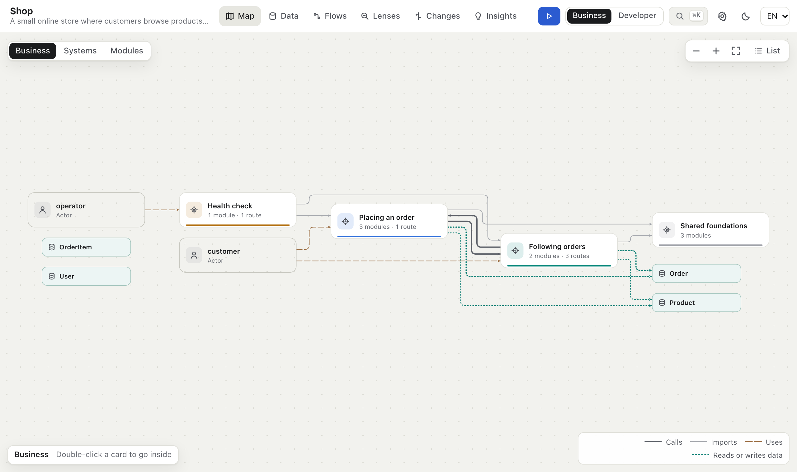
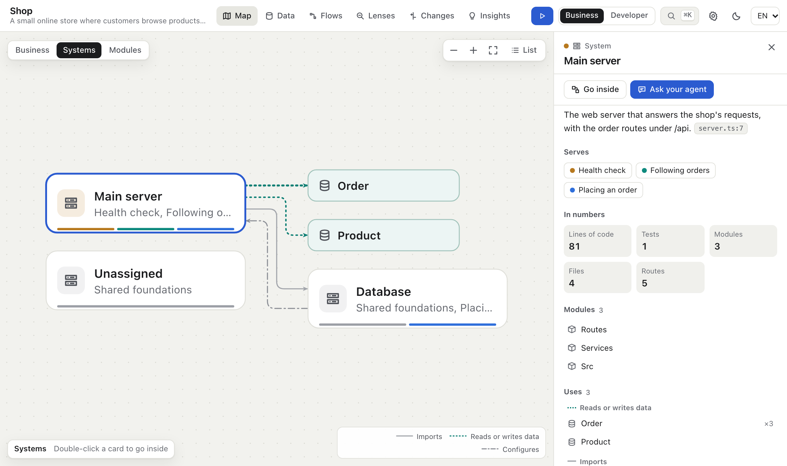
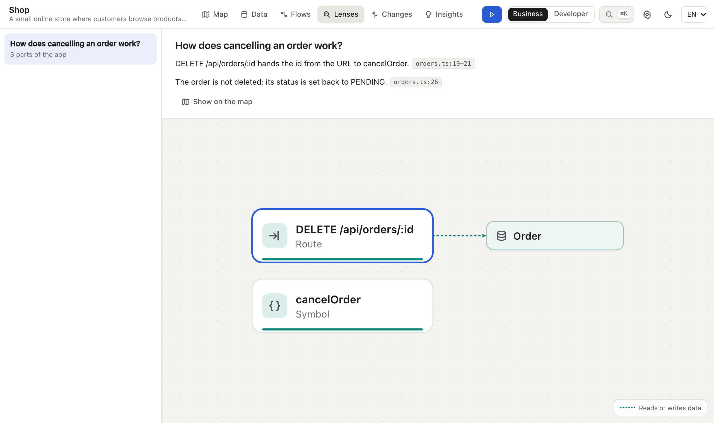

# ultraview

**See your app instead of reading its code.** Nobody reads the whole codebase
any more, least of all the people who decide what it should do. ultraview
gives the business and the developers one shared, cited picture of the app:
what it does (capabilities), what runs where (systems), its data, its flows,
the questions people asked about it, and every change the agent made. The
agent builds it with you, keeps it fresh, and every sentence on it points at
the line of code it rests on.

It is the visual layer of a family: [codeindex](https://github.com/maxgfr/codeindex)
says where things are, [ultraindex](https://github.com/maxgfr/ultraindex) says
what they mean and proves it, ultraview shows it.

```bash
npx skills add maxgfr/ultraview
```

| Business level | Systems, with the side panel | A saved question |
|---|---|---|
|  |  |  |

The page behind these is committed: [assets/example/index.html](assets/example/index.html),
one offline file (download it and open it). It maps the shop fixture of the
tests with its test model, flow and lens; `node scripts/example.mjs` rebuilds
it.

## Invocation

**On request by default.** The agent may call ultraview when you ask for it,
and you can invoke it directly with `/ultraview` in Claude Code or
`$ultraview` in Codex. It does not start on its own. One setting makes it
explicit-only: see [On request or explicit-only](#on-request-or-explicit-only).

```
/ultraview map this app
/ultraview how do refunds work?
/ultraview what did you just change?
/ultraview explain the app to the business, as a brief for the README
/ultraview keep the map open while we work
```

## Why

An agent now writes much of the code, and people review it by asking, not by
reading. What they lack is the overview: which parts exist, what each one is
for, how a request travels, where the data lives, and what this afternoon's
change touched. Drawn by hand it goes stale in a week; written by a model
alone it reads well and may be wrong.

So ultraview splits the work. What code can compute, code computes,
deterministically: the files, symbols, imports, routes, data models, jobs,
outside services, the diff, the blast radius, the risk and the layout. What
needs a reader, the model writes: the systems, the capabilities, the flows,
the answers. And what the model writes cannot be unfounded: `check` refuses a
sentence without a citation, a citation that does not resolve, a node id that
does not exist, and coverage below its thresholds.

## How it works

```
your repo
  ├─ codeindex (vendored, via ultraindex)  files, symbols, imports, call graph, git history
  ├─ ultraview extractors                  routes, calls, screens, entities, jobs, externals, infra
  └─ the agent                             systems, capabilities, flows, lenses   (every sentence cited)
        │
        ▼
  .ultraview/view.json  ──render──▶  .ultraview/index.html  (one offline page)
                        ──serve───▶  http://127.0.0.1:4178   (live, with Ask)
```

1. `build` refreshes the ultraindex index (incremental), runs the extractors
   over every indexed file and merges everything into a view-model. It prints
   a short summary; the agent never reads the data files.
2. The agent reads the README, manifests and entrypoints, writes `systems`
   (≥ 90% of code files), then each capability from `dossier <node-id>`
   evidence (≥ 70% of modules), then 1–3 flows and a tour. `check` gates it.
3. `render` or `serve` draws it: Business → Systems → Modules → Files →
   Symbols, the data models, flows, saved questions, changes and insights.
4. A question becomes a **lens**: `lens new` gives the evidence, the agent
   writes a cited answer, `lens save` stamps the hash of every cited file, and
   the answer is a view anyone can reopen at `#lens=<id>`, greyed when the code
   under it changes.
5. A change becomes a **change set** and a **timeline** entry: `diff
   --worktree --record` maps the delta on every level, with blast radius,
   per-module risk and broken imports; `diff --markdown` prints the PR body.

## Using it

Ask in plain words; the skill routes from `ultraview status` and your intent.

| You say | It does |
|---|---|
| "map this app" | build, systems, capabilities, flows, tour, check, then opens the map |
| "how does X work?" | a cited lens, saved, linked as `#lens=<id>` |
| "what did you change?" / "summarise this PR" | `diff --record` with a cited summary; `diff --markdown` for the PR |
| "explain it to the business" | a plain-words model and `export --md` (a brief), `--mermaid` or `--svg` |
| "keep it open" | `serve --open`: the page updates as `.ultraview/` changes |
| "what should we worry about?" | `insights`: hotspots, hidden coupling, cycles, dead code, untested hubs, repeated literals |
| "update the map" | `build`, then only what `status` names as stale |

The CLI is usable by hand too: `node skills/ultraview/scripts/ultraview.mjs --help`.

### Install

```bash
npx skills add maxgfr/ultraview             # this project
npx skills add maxgfr/ultraview --global    # user-level, every project
npx skills add maxgfr/ultraview -a codex    # optional: target one agent
```

The skill installs self-contained (`SKILL.md`, its references, the committed
bundle and the viewer), so it runs with `node` 18+ alone: no `npm install`, no
API key. The first `build` on a machine downloads the tree-sitter grammars
once into a shared cache (`--no-ast` skips them).

## Proving it

`pnpm run eval` runs the offline suite in [evals/](evals/README.md) against
fixture repositories, in temp copies, through the committed bundle:

- **Ranking.** 6 questions about the shop fixture, each in 5 English and 5
  French paraphrases: `lens new` must put the key nodes in its top 10
  candidates. 29/30 English, 29/30 French (14/30 and 3/30 before the ranking
  this release ships). A held-out set on another fixture (Next.js + Drizzle,
  no model, generated after the tuning): 24/30 English, 26/30 French.
- **Gates.** For each question, a good answer must pass `lens save` and
  `check`, hold the key nodes and cite the right files; a bad one must fail
  with the expected reason: an uncited sentence, a citation past the end of a
  file, an unknown node id, a file that does not exist, citations moved to the
  wrong file, a missing key node. The same for a model and a flow.

The questions were generated by GLM 5.3 flash (open weights, MIT); the
provenance of every file is in [evals/README.md](evals/README.md). CI runs the
suite on every push.

## What it reads and writes

- Reads: the repository's indexed files, git history (churn, change
  coupling, diffs), and nothing on the network but the one-time grammar
  download.
- Writes `.ultraindex/` (the index) and `.ultraview/`:

| file | who | committed |
|---|---|---|
| `model.json`, `flows/`, `lenses/` | the agent | yes: the meaning, reviewable in PRs |
| `timeline.jsonl`, `changes/` | `diff --record`, `timeline add` | yes: the history |
| `facts.json`, `view.json`, `index.html`, `hook.log`, `ask.log` | the CLI | no (`.ultraview/.gitignore`) |

Nothing committed holds a machine-local path. Outside `.ultraview/`, only
`hook install` writes, when you ask: `.claude/settings.local.json`.

## Handing it to agents

- **Any agent the `skills` CLI supports** runs the skill: the whole loop is
  `node` commands and JSON files.
- **Serve with Ask**: `serve --ask auto|claude|codex|none` lets the page send
  a question to the Claude Code or Codex CLI, read-only, and saves the answer
  as a lens. Only one ask at a time; nothing else is written.
- **Record every turn**: `hook install` (Claude Code only, opt-in) records
  each agent turn as a change set, silently, never failing the turn.
- **Big repos**: the skill fans out one subagent per capability where the host
  has subagents, and does the same steps in order where it does not
  ([orchestrate](skills/ultraview/references/orchestrate.md)).

## Limits

- **Languages.** The extractors cover JS/TS and Python web stacks: Express,
  Fastify, Hono, NestJS, Next, Nuxt, SvelteKit, Remix, FastAPI, Flask, Django,
  tRPC, server actions; Prisma, Drizzle, TypeORM, Mongoose, Sequelize,
  SQLAlchemy, Django ORM, SQL. Go, Java, Ruby, PHP and .NET apps get files,
  symbols and imports (codeindex) but no routes or entities.
- **Known gaps** ([src/extract/README.md](src/extract/README.md)): NestJS
  `setGlobalPrefix` and versioning, Fastify autoload, React Router v7 config
  routes, SvelteKit form actions, Next `basePath`, calls through Angular
  `HttpClient` or SWR / React Query keys, tRPC v9 string paths, routers
  re-exported through barrels, tsconfig `paths` aliases.
- **Externals.** An app's own public URL used as a configuration default
  counts as an external; a URL reaching a call through an attribute stays a
  link ([tests/corpus.md](tests/corpus.md)).
- **One repository at a time**: no cross-repo request matching.
- **No security checks.** Insights are engineering signals from the engine,
  not an audit: no secrets, auth or webhook checks.
- **No prose per file.** Files and symbols show engine data (size, tests,
  churn, edges), not a written description; the model writes at the system,
  capability, flow and question level.
- **French questions** are bridged by a small lexicon of everyday app words;
  other languages rank on their own words only.
- `render` and `serve` redraw saved model, flow and lens edits without
  re-indexing, but code changes need `build`: until then the map shows the
  code as of the last build, and both say the index is stale.

## How it compares

[floorplan](https://github.com/haydenschmitty/floorplan) is the closest tool
and the better-known one (6.9k stars and 636 forks a month after its
repository was created; v0.11.0). Both are agent skills that draw a zoomable, plain-English
map of an app, with flows, a tour, an Ask box and highlights of recent work;
both keep the mechanical work in zero-dependency Node scripts. The claims
below come from its README, its `SKILL.md` and its open issues as of
2026-11-26.

| | floorplan | ultraview |
|---|---|---|
| Deepest level | files and endpoints | symbols, with the symbol call graph on demand (`/api/callgraph`) |
| Business layer | parts and modules (`architecture.json`) | capabilities as an overlay (one file can serve several), with actors |
| Data | databases as external nodes; no entity or relation view in its README | entities and relations from 7 ORMs and SQL schemas, a data view, who reads and writes each one |
| Saved questions | an answer is gone when closed or reloaded ([#183](https://github.com/haydenschmitty/floorplan/issues/183), [#129](https://github.com/haydenschmitty/floorplan/issues/129), [#22](https://github.com/haydenschmitty/floorplan/issues/22)) | each answer is a committed lens, reopened at `#lens=<id>` |
| Change history | Recent work "replaces the previous highlights" on every update (its `SKILL.md`) | append-only timeline and change sets, a blast radius and risk per module, PR markdown |
| Staleness | a description is flagged only when exports, routes or the first doc sentence change ([#193](https://github.com/haydenschmitty/floorplan/issues/193)) | the hash of every cited file; any edit makes the lens or flow stale |
| Sharing | `floorplan/` ignores itself in git, so teammates' maps don't sync ([#174](https://github.com/haydenschmitty/floorplan/issues/174)) | the meaning and history in `.ultraview/` are committed; generated files are ignored |
| Model cost | the agent describes every file and route (~740 file and ~497 route descriptions on one large repo, [#95](https://github.com/haydenschmitty/floorplan/issues/95)) | facts are extracted; the model writes systems, capabilities, flows and answers only |
| Verification | schema and plain-language warnings; no citations | every sentence cites `[path:line]`; `check` fails dead citations, uncited sentences, unknown ids, low coverage |
| Findings | Health: secrets, Supabase RLS, Firebase rules, Stripe webhooks, CORS, open endpoints, unused and large files; 16 open issues titled "False positive: …" | engine insights: hotspots, hidden coupling, cycles, dead code, untested hubs, repeated literals |
| Agents | Claude Code and Codex plugins (pi and Qoder requested: [#179](https://github.com/haydenschmitty/floorplan/issues/179), [#124](https://github.com/haydenschmitty/floorplan/issues/124)) | any agent `npx skills add` supports; Ask for Claude Code and Codex; the hook for Claude Code |
| Evals | tests in CI; no answer-quality evals in its README | `pnpm run eval`: ranking recall and good / bad answers through the gates |

What floorplan does that ultraview does not:

- **Far more stacks**: Go (net/http, Gin, Echo, chi), Rust (Actix, Axum),
  Spring, ASP.NET Core, Laravel, Firebase and Supabase functions, Serverless,
  `Bun.serve`; screens for Astro, Expo, Angular, TanStack, Shopify themes,
  Inertia.
- **Several repositories at once**, with frontend requests matched to backend
  endpoints across repos.
- **Security health checks**, with a fix prompt for each.
- **A plain-English description of every file and route.**
- **Blueprints**: a map planned from a PRD before any code exists.
- "Start from a screen", an export without Ask, paths or remotes, a live demo
  and a video, and a month of fixes from a large user base.

ultraview is younger and narrower in stacks. It is deeper (symbols, data,
capabilities), it keeps what people asked and what the agent changed, and it
proves what it writes.

**ultraindex and codeindex** are not alternatives: ultraview vendors
ultraindex's library, which carries codeindex. Use codeindex to find code
fast, ultraindex for a cited per-module encyclopedia an agent can load, and
ultraview to see the app and share it.

## License

MIT. The viewer bundles Preact (MIT) and elkjs (EPL-2.0): see [NOTICE](NOTICE).

## On request or explicit-only

The skill ships **model-invocable, on request**: the agent may call it
through its skill tool, but the description restricts it to explicit
requests, so it runs when you ask, not on its own. Install it with `npx
skills add maxgfr/ultraview`, or use the bundle directly: `node
skills/ultraview/scripts/ultraview.mjs --help`.

Making it explicit-only is one setting, read by Claude Code and OpenCode,
applied to the **installed** copy of the skill:

| Host | Shipped, on request | Explicit-only |
| --- | --- | --- |
| Claude Code, OpenCode | no `disable-model-invocation` in `SKILL.md` | add `disable-model-invocation: true` |

Claude Code can do it without touching the file:
`"skillOverrides": { "ultraview": "user-invocable-only" }` in `settings.json`
leaves `/ultraview` working while hiding the skill from the model.
