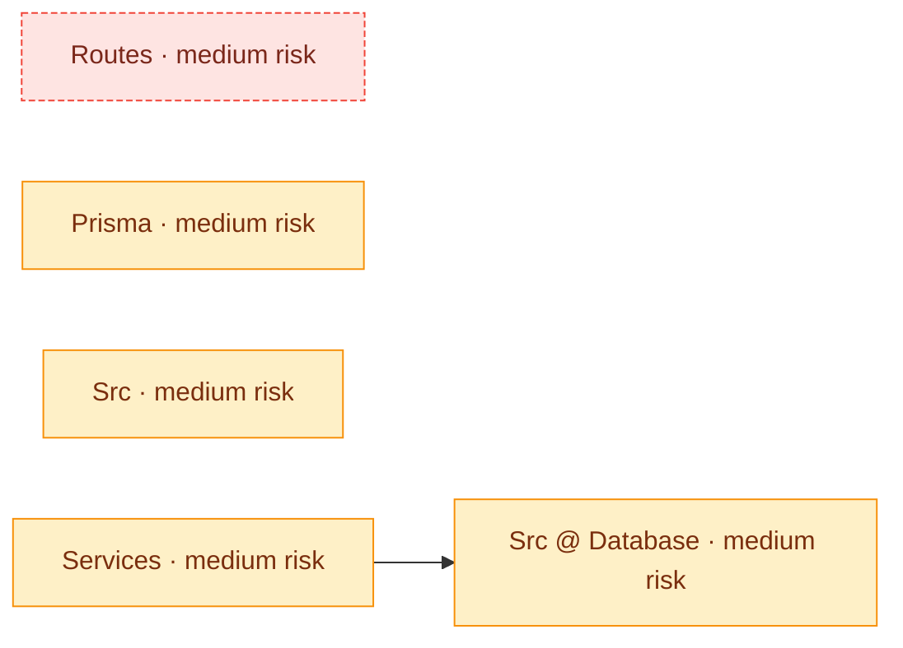

## Change summary

**6 files changed** (1 added, 4 changed, 1 removed) and **0 impacted** within 2 hops: uncommitted changes against `HEAD` (`<base>`).

### What it touches

- **Capabilities**: changed Shared foundations, Health check, Following orders, Placing an order.
- **Systems**: changed Main server, Database.
- **Routes**: added `GET /version`; removed `DELETE /api/orders/:id`, `GET /api/orders`, `GET /api/orders/:id`, `POST /api/orders`; impacted `GET /health`.
- **Data**: changed `Order`; impacted `OrderItem`, `Product`, `User`.

### Risk

| Module | Risk | Score | Tests | Why |
|---|---|---|---|---|
| Prisma (`prisma`) | medium | 45 | gap | exported symbols Order, note changed; no test covers this module |
| Src (`src`) | medium | 45 | covered | exported symbols app, refund changed; pagerank p100 hub |
| Services (`src/services`) | medium | 45 | gap | exported symbol cancelOrder changed; no test covers this module |
| Routes (`src/routes`) | medium | 40 | n/a | removed src/routes/orders.ts is still imported by 1 file (src/server.ts) |

### Broken imports

- `src/server.ts` still imports `./routes/orders.js`, which was `src/routes/orders.ts` (removed).

### Impacted map

